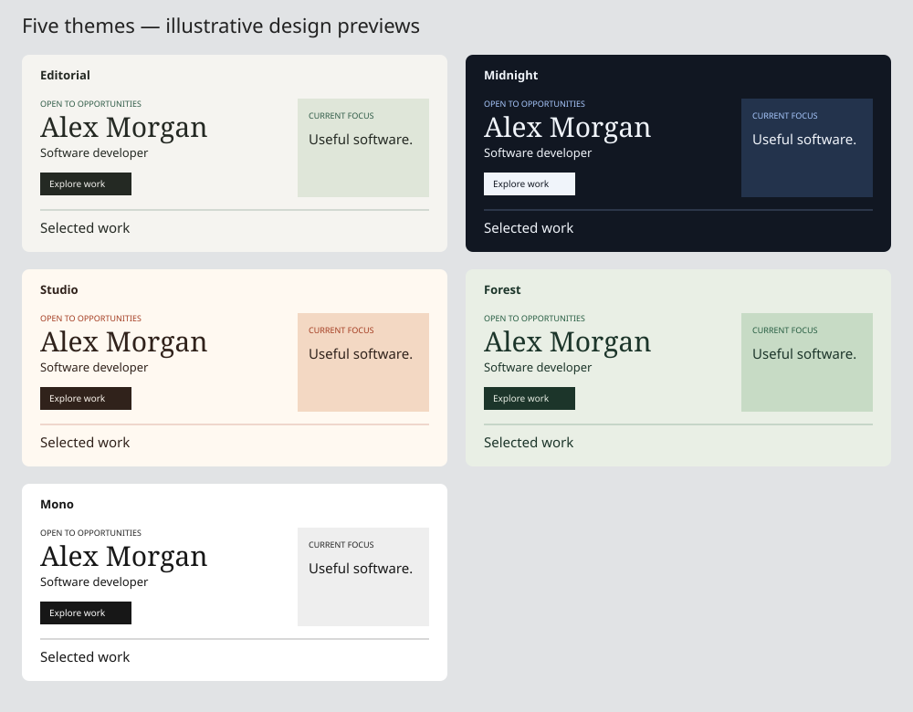
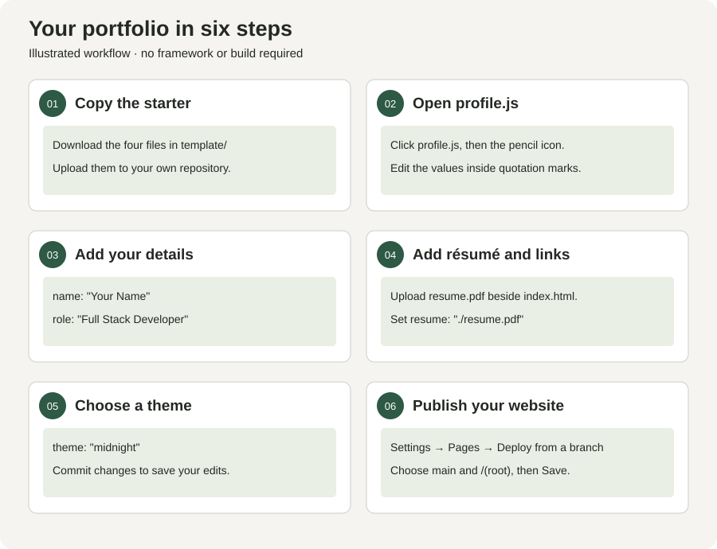

# Portfolio — a minimal developer website

Five themes. One profile file. No framework, build step, package manager or paid hosting.

## Try the template

[Personal portfolio](https://vamshikrishnakodati.github.io/vamshi-portfolio/) · [Template demo (after deployment)](https://vamshikrishnakodati.github.io/vamshi-portfolio/template/)

## Start here — illustrated beginner guide

**[Read the full step-by-step guide](template/GETTING_STARTED.md)** — includes where to click, before-and-after code, personal information, projects, résumé, WhatsApp, themes and publishing.

## Make it yours

1. Download **only the contents of the `template/` directory** from this repository. Do not fork the personal résumé or copy the personal site at the repository root.
2. Create a new public repository in your own GitHub account.
3. Upload `index.html`, `styles.css`, `profile.js`, and `app.js` to its root.
4. Edit `profile.js`: name, role, location, projects, skills, experience, email and optional WhatsApp, GitHub and LinkedIn.
5. Add your own approved `resume.pdf` and set `resume: "./resume.pdf"`. Add project images using relative paths.
6. In Settings → Pages → Deploy from a branch, select main and /(root), then Save.
7. Open the published URL and test it in an incognito window.

## Themes

| Theme | Character |
| --- | --- |
| Editorial | Warm paper and evergreen |
| Midnight | Dark navy and ice blue |
| Studio | Warm cream and terracotta |
| Forest | Soft sage and deep green |
| Mono | Black and white, monospace headlines |

Set the default in profile.js. Visitors can switch themes; their choice is saved locally when storage is available.

## Maintain the code

- profile.js: all editable content
- index.html: semantic page structure
- styles.css: shared layout and theme tokens
- app.js: safe text rendering, optional links and theme selection

Run `python -m http.server 8000` inside the template directory, then open http://localhost:8000. No build required. Keep new features small and avoid adding dependencies without a clear need.

## Before publishing

- [ ] Replace every sample detail and project.
- [ ] Add your own PDF and verify download.
- [ ] Test WhatsApp with international digits and email.
- [ ] Test all five themes, keyboard navigation and mobile layout.
- [ ] Check console and network for errors.
- [ ] Review personal data before publishing.

The image above is an illustrative SVG preview, not a browser screenshot. Actual screenshots and browser verification are pending.

## Scope

The reusable starter is separate from the original personal portfolio so the existing recruiter site and résumé are preserved. Only the starter files are intended for reuse.