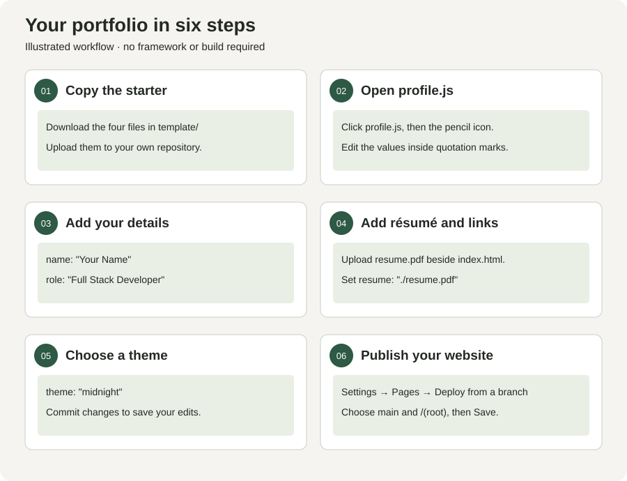
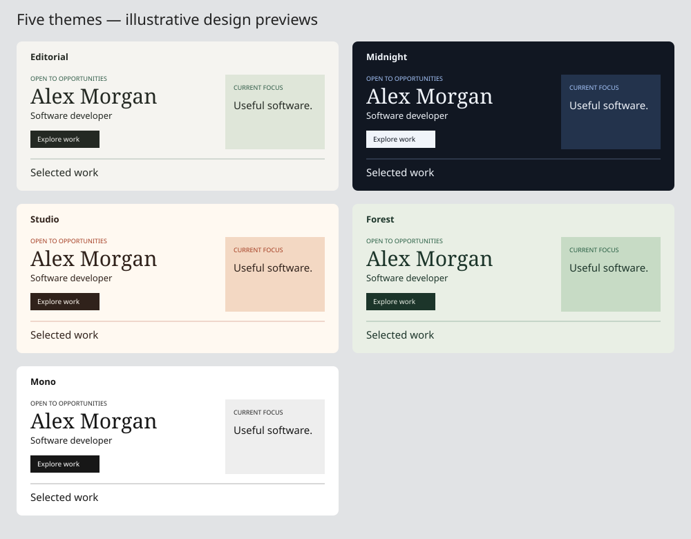

# Beginner's guide: create your own portfolio



## 1. Copy the starter

Open the [template folder](https://github.com/VamshikrishnaKodati/vamshi-portfolio/tree/main/template). Open each of the four files below and use GitHub's download raw file control, or download the repository ZIP and extract only these files. Create a new public repository in your account. Use **Add file → Upload files** and commit the four files to its root.

```text
your-portfolio/
├── index.html
├── styles.css
├── app.js
└── profile.js  ← edit this file
```

Do not copy the original personal portfolio or its résumé.

## 2. Open the editor

In your new repository, click **profile.js → pencil icon (Edit this file)**. Change the values inside quotation marks. Keep the field names, commas and brackets. Click **Commit changes** to save.

## 3. Change your personal information

Before:

```js
name: "Alex Morgan",
role: "Software developer",
location: "Your city, country",
```

After (example):

```js
name: "Priya Sharma",
role: "Full Stack Developer",
location: "Hyderabad, India",
```

| Field | What appears on your website |
| --- | --- |
| name | Header and large hero heading |
| role | Job title below your name |
| availability | Open-to-work status |
| location | Location in the focus panel |
| intro | Short introduction |
| focus | Current focus panel |
| about | About section |
| skills | Skill tags |

Example skills: `skills: ["Python", "React", "SQL"],`

## 4. Add projects and experience

Replace the existing sample objects inside the projects array. Example:

```js
projects: [
  {
    title: "Expense Tracker",
    description: "Built a dashboard to track monthly expenses.",
    stack: ["Python", "SQL"],
    image: "./images/expense.png",
    url: "https://github.com/your-username/expense-tracker"
  }
],
experience: [
  {
    title: "Developer Intern",
    organization: "Example Company",
    dates: "2025–2026",
    description: "Built and tested application features."
  }
]
```

Upload your project image to the matching path in your repository, or use an empty string for image and url if unavailable. Separate multiple objects with commas. Leave experience as [] if you have none.

## 5. Add résumé and contact links

Use **Add file → Upload files** to upload your own approved PDF as resume.pdf beside index.html. Edit profile.js:

```js
resume: "./resume.pdf",
email: "you@example.com",
whatsapp: "", // enter country code + number, digits only
github: "https://github.com/your-username",
linkedin: "",
```

For an Indian WhatsApp number, enter 91 followed by your ten-digit number, without +, spaces or hyphens. Empty contact fields are hidden. Only publish information you want everyone to see.

## 6. Pick a theme

Change the theme field to one of these exact values:

| Value | Style |
| --- | --- |
| editorial | Warm paper and green |
| midnight | Dark navy |
| studio | Cream and terracotta |
| forest | Sage green |
| mono | Black and white |

Example: `theme: "midnight",`



Visitors can switch themes from the header. Test the default in a private browser window because a previously saved preference can override it.

## 7. Publish for free

In your own repository:

```text
Settings
  └── Pages
       └── Build and deployment
            ├── Source: Deploy from a branch
            ├── Branch: main
            ├── Folder: /(root)
            └── Save
```

Wait for GitHub Pages to finish deploying. Open the website URL displayed in Settings → Pages. For a normal project repository it is usually https://YOUR-USERNAME.github.io/YOUR-REPOSITORY/.

## 8. Final checks

- [ ] My name, role and projects appear correctly.
- [ ] My résumé downloads and opens.
- [ ] Email, WhatsApp, GitHub and LinkedIn links work if configured.
- [ ] All five themes work.
- [ ] The site fits my phone screen.
- [ ] No sample personal information remains.
- [ ] I can open the published URL in a private browser window.

If changes do not appear, check deployment status, confirm you committed to the published branch, and refresh. If the page is blank, check profile.js for missing quotes, commas or brackets.

The illustrations are schematic guides, not screenshots of the GitHub interface.
